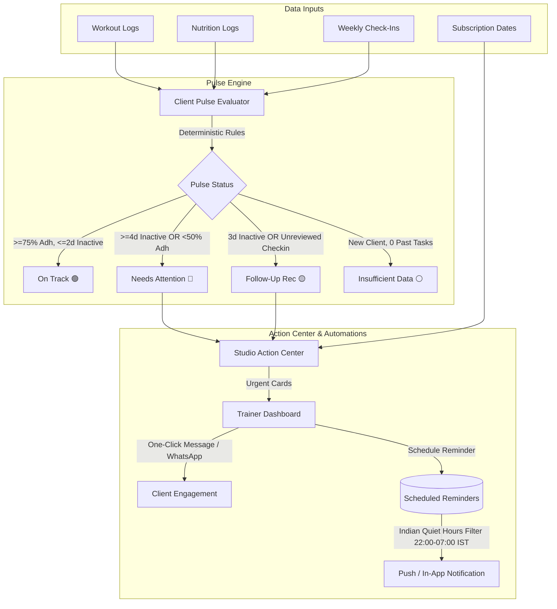

# FitPlus Client Pulse & Retention Automation Architecture

> **Module**: FitPlus Client Pulse, Studio Action Center & Scheduled Automations  
> **Target Audience**: Coaches, Operations Leads, Full-Stack Engineers  
> **Technologies**: TypeScript, Cloud Firestore, Local Notification Engine, Indian Timezone Rules (IST)  

---

## 1. Executive Overview

Client retention is the cornerstone of sustainable online fitness coaching. FitPlus provides coaches with an algorithmic **Client Pulse** engine that evaluates client engagement in real time, surfaces high-priority interventions through the **Studio Action Center**, and automates routine reminders while respecting cultural norms such as Indian Quiet Hours.



---

## 2. Deterministic Client Pulse Algorithm (`src/lib/pulseEngine.ts`)

Unlike black-box AI scores that cannot be explained to clients or coaches, FitPlus uses transparent, deterministic rules to classify each client into one of four distinct states:

### 2.1 State Classification Rules

$$\text{Adherence Rate} = \frac{\text{Completed Workouts \& Habit Tasks in last 14 days}}{\text{Assigned Tasks in last 14 days}} \times 100$$
$$\text{Days Inactive} = \text{Current Date} - \text{Date of Most Recent Workout or Meal Log}$$

| State | Badge | Deterministic Trigger Conditions | Default Action |
|---|---|---|---|
| **`on_track`** | 🟢 Green | Adherence $\ge 75\%$ **AND** Days Inactive $\le 2$. | Send encouragement; celebrate workout streaks. |
| **`needs_attention`** | 🔴 Crimson | Days Inactive $\ge 4$ **OR** Adherence $< 50\%$ **OR** 0 workouts logged despite past assignments. | Immediate outreach; evaluate plan difficulty or injury. |
| **`follow_up_recommended`** | 🟡 Amber | Days Inactive $= 3$ **OR** Adherence between $50\%$ and $74\%$ **OR** Pending unreviewed check-in. | Review weekly check-in; send mid-week motivation. |
| **`insufficient_data`** | ⚪ Slate | Client onboarded within last 3 days **AND** 0 past scheduled tasks. | Guide onboarding; schedule initial orientation call. |

### 2.2 Client Pulse Output Schema
```typescript
interface ClientPulseSummary {
  clientId: string;
  clientName: string;
  status: 'on_track' | 'needs_attention' | 'follow_up_recommended' | 'insufficient_data';
  adherencePercentage: number;
  daysInactive: number;
  lastActiveDate: string | null;
  pendingCheckIn: boolean;
  activeStreak: number;
  attentionReasons: string[];
}
```

---

## 3. Trainer Studio Action Center (`StudioOverviewPage`)

The Studio Action Center aggregates operational tasks across all assigned clients, ranking them by urgency so coaches know exactly where their attention is needed each day.

### 3.1 Priority Scoring Model
Each actionable item receives a numerical urgency score:
- **Urgent (Priority Score 80–100)**:
  - Client inactive for $\ge 5$ days (+40)
  - Subscription expiring within 48 hours without renewal (+30)
  - Unread client message $>12$ hours old (+25)
- **Warning (Priority Score 50–79)**:
  - Client inactive for 3–4 days (+25)
  - Unreviewed weekly check-in submitted $>24$ hours ago (+20)
  - Adherence dropped below 50% (+20)
- **Info (Priority Score 10–49)**:
  - Client hit a major milestone (14-day streak, personal record)
  - New client onboarded

### 3.2 Action Center Cards & Quick CTAs
Cards display client name, avatar, reason pill, and direct one-click actions:
- **Message Client**: Navigates straight to the FitPlus Connect thread (`/studio/messages?client={id}`).
- **Review Check-in**: Opens the check-in modal for feedback and photo review.
- **WhatsApp Nudge**: Opens `WhatsAppShareModal` with pre-filled context template.

---

## 4. Scheduled Reminder Architecture & Indian Quiet Hours

### 4.1 Reminders Schema (`/scheduledReminders/{reminderId}`)
```typescript
interface ScheduledReminder {
  id: string;
  trainerUserId: string;
  clientUserId: string;
  reminderType: 'check_in' | 'workout' | 'nutrition' | 'subscription_renewal' | 'custom';
  title: string;
  messageText: string;
  scheduledFor: string; // ISO 8601
  status: 'pending' | 'sent' | 'cancelled';
  sentAt?: string;
  createdAt: string;
}
```

### 4.2 Indian Quiet Hours Protection (`isInIndianQuietHours`)
FitPlus strictly enforces quiet hours according to Indian Standard Time (IST, UTC+05:30):

```typescript
export function isInIndianQuietHours(date: Date = new Date()): boolean {
  // Convert current UTC time to IST (UTC + 5 hours 30 minutes)
  const istOffsetMs = 5.5 * 60 * 60 * 1000;
  const istDate = new Date(date.getTime() + istOffsetMs);
  const istHours = istDate.getUTCHours();

  // Quiet hours: 10:00 PM (22:00) to 07:00 AM IST
  return istHours >= 22 || istHours < 7;
}
```

**Execution Policy**:
- Any automated reminder scheduled to trigger during quiet hours (22:00–07:00 IST) is delayed until 07:30 AM IST.
- Coaches attempting to schedule manual reminder alerts during quiet hours receive an advisory notice in the UI.

---

## 5. Trainer Business Analytics Engine (`src/lib/pulseEngine.ts`)

Coaches can monitor their operational health through key business metrics computed client-side:

1. **Monthly Recurring Revenue (MRR)**:
   $$\text{MRR} = \sum_{\text{activeSubscriptions}} \frac{\text{packagePriceINR}}{\text{durationMonths}}$$
2. **Active Coaching Clients**: Count of clients with active subscriptions and valid coach-client relationships.
3. **Average Roster Adherence**: Mean adherence rate across all active clients over the past 14 days.
4. **Weekly Check-In Compliance**: Percentage of eligible clients who completed their check-in for the current week.
