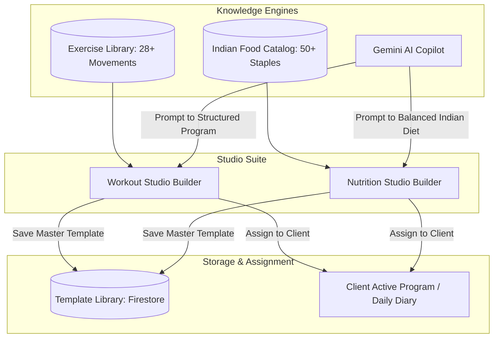

# FitPlus Workout Studio & Nutrition Studio Architecture

> **Module**: FitPlus Coaching Builders (Workout Studio & Nutrition Studio)  
> **Target Audience**: Fitness Coaches, Nutrition Specialists, Engineers  
> **Technologies**: React 19, TypeScript, Cloud Firestore, Gemini AI (`@google/genai`), Indian Food Database (IFCT/NIN)  

---

## 1. Overview & Vision

The FitPlus Coaching Builders empower fitness trainers to build, edit, and deliver personalized, evidence-based workout routines and culturally relevant Indian nutrition plans in minutes. Rather than forcing trainers to use awkward spreadsheets, FitPlus provides dedicated visual studios designed around the daily coaching workflow.



---

## 2. FitPlus Workout Studio (`StudioWorkoutBuilderPage`)

### 2.1 Domain Data Model
Programs are organized hierarchically: **Program $\rightarrow$ Weeks $\rightarrow$ Days $\rightarrow$ Exercises $\rightarrow$ Sets**.

```typescript
interface VisualWorkoutExercise {
  id: string;
  exerciseId: string; // Links to exerciseLibrary.ts
  exerciseName: string;
  targetMuscleGroup: string;
  sets: number;
  reps: string; // e.g. "8-12", "AMRAP", "10"
  targetWeightKg?: number;
  rpe?: number; // 1-10
  restSeconds: number; // e.g. 60, 90, 120
  notes?: string;
}

interface VisualWorkoutDay {
  dayIndex: number; // 0..6
  dayTitle: string; // e.g. "Push Strength & Hypertrophy"
  targetMuscles: string[];
  exercises: VisualWorkoutExercise[];
  isRestDay: boolean;
}

interface VisualWorkoutWeek {
  weekNumber: number; // 1..N
  focus: string; // e.g. "Hypertrophy Phase", "Deload"
  days: VisualWorkoutDay[];
}

interface WorkoutProgramTemplate {
  id: string;
  trainerUserId: string;
  title: string;
  description: string;
  goal: 'fat_loss' | 'muscle_gain' | 'strength' | 'general_fitness';
  experienceLevel: 'beginner' | 'intermediate' | 'advanced';
  equipmentRequired: string[];
  weeks: VisualWorkoutWeek[];
  isPublic: boolean;
  createdAt: string;
  updatedAt: string;
}
```

### 2.2 Integration with Exercise Library (`src/data/exerciseLibrary.ts`)
- Features 28+ curated multi-joint and isolation exercises with verified video references, instructions, common mistakes, and equipment tags.
- Coaches can search by muscle group (Chest, Back, Shoulders, Quads, Hamstrings, Core, etc.) and equipment availability (Gym, Dumbbells, Bodyweight, Resistance Bands).
- Adding an exercise auto-populates optimal default rest times, rep ranges, and safety instructions.

### 2.3 Live Workout Metrics Engine
The builder computes volume and workload metrics as coaches adjust sets and reps:
$$\text{Total Sets} = \sum_{i=1}^{N} \text{sets}_i$$
$$\text{Estimated Time (min)} = \sum_{i=1}^{N} \left( \text{sets}_i \times \frac{45\text{s}}{60} + (\text{sets}_i - 1) \times \frac{\text{restSeconds}_i}{60} \right) + 5\text{ min warm-up}$$

---

## 3. FitPlus Nutrition Studio (`StudioNutritionBuilderPage`)

### 3.1 Domain Data Model
Diet plans are structured around authentic Indian meal timings:

```typescript
interface VisualNutritionMealItem {
  id: string;
  foodId: string; // Links to indianFoods.ts
  name: string;
  category: string;
  servingUnit: string; // e.g. "katori", "phulka", "piece", "bowl", "100g"
  servingQuantity: number;
  calories: number;
  proteinGrams: number;
  carbsGrams: number;
  fatGrams: number;
  notes?: string;
}

interface VisualNutritionMealSlot {
  slotId: 'breakfast' | 'mid_morning' | 'lunch' | 'evening_snack' | 'dinner' | 'post_workout';
  title: string;
  timeHint: string; // e.g. "08:30 AM"
  items: VisualNutritionMealItem[];
}

interface VisualNutritionDay {
  dayIndex: number;
  dayTitle: string;
  slots: VisualNutritionMealSlot[];
}

interface NutritionProgramTemplate {
  id: string;
  trainerUserId: string;
  title: string;
  dietType: 'vegetarian' | 'eggetarian' | 'non_vegetarian' | 'vegan' | 'jain';
  targetCalories: number;
  targetProteinGrams: number;
  targetCarbsGrams: number;
  targetFatGrams: number;
  days: VisualNutritionDay[];
  guidelines: string[];
  isPublic: boolean;
  createdAt: string;
  updatedAt: string;
}
```

### 3.2 Indian Food Catalog Integration (`src/data/indianFoods.ts`)
- Derived from standard Indian Food Composition Tables (IFCT) and National Institute of Nutrition (NIN) benchmarks.
- Contains 50+ staple Indian dishes, whole grains, pulses, dairy items, and protein sources.
- **Dynamic Portion Scaling**: Items scale dynamically with Indian serving metrics:
  ```typescript
  export function scaleIndianFoodItem(item: IndianFoodItem, quantity: number): VisualNutritionMealItem {
    const factor = quantity / item.baseServingQuantity;
    return {
      id: crypto.randomUUID(),
      foodId: item.id,
      name: item.name,
      category: item.category,
      servingUnit: item.servingUnit,
      servingQuantity: quantity,
      calories: Math.round(item.calories * factor),
      proteinGrams: Math.round(item.proteinGrams * factor * 10) / 10,
      carbsGrams: Math.round(item.carbsGrams * factor * 10) / 10,
      fatGrams: Math.round(item.fatGrams * factor * 10) / 10,
    };
  }
  ```

### 3.3 Live Macro & Calorie Bar
As items are added or portions adjusted, the studio calculates real-time totals:
$$\text{Total Calories} = \sum \text{calories}_i$$
$$\text{Total Protein} = \sum \text{protein}_i, \quad \text{Total Carbs} = \sum \text{carbs}_i, \quad \text{Total Fat} = \sum \text{fat}_i$$
Visual comparison bars alert the coach if the total exceeds or falls short of the client's macro goals.

---

## 4. Gemini AI Copilot Integration

Coaches can leverage Gemini AI to draft complex programs in seconds using natural language prompts.

### Gemini AI Prompt & Schema Pipeline
1. **Coach Input**: Goal, Target Calories, Dietary Preferences (e.g., *"Pure vegetarian, 1800 kcal, 100g protein, north-Indian staples"* or *"4-day upper/lower split for fat loss with dumbbells only"*).
2. **Serverless AI Handler**: `/api/ai/generate-plan` calls Gemini (`@google/genai`) with structured JSON schema constraints matching `VisualWorkoutWeek` or `VisualNutritionDay`.
3. **Deterministic Fallback**: If the API call times out or encounters network limits, local rule-based generators construct a verified template immediately.
4. **Trainer-in-the-Loop Review**: AI outputs are loaded directly into the visual studio editor, allowing coaches to tweak exercises, adjust portions, and add personal tips before assigning to the client.

---

## 5. Template Library & Client Assignment

- **Master Template Library**: Coaches can save custom creations to `/workoutTemplates` and `/nutritionTemplates` with tag filtering.
- **Single-Click Client Assignment**: When viewing a client profile in the Trainer Studio, coaches can choose any template from their library and assign it immediately.
- **Client Synchronization**: Assigned templates populate the client's live workout sessions and daily nutrition diary, sending an in-app notification and an optional WhatsApp notification via the FitPlus Connect bridge.
