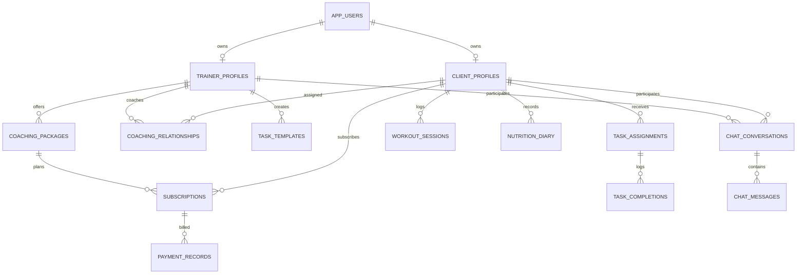

# FitPlus Relational Database Schema — PostgreSQL

## 1. Schema Conventions

- **Identifier Strategy**: Firebase UIDs are variable alphanumeric strings (e.g. `rnmf3FFBtuVH15ASOGoOhZfT1TD2`). All user foreign keys are stored as `TEXT`. Document IDs use domain prefixes (e.g., `tr_`, `cl_`, `rel_`, `pay_`).
- **Timestamps**: All temporal columns use `TIMESTAMPTZ` with default `now()`.
- **Financial Minor Units**: Monetary amounts are stored as exact integers in paise (`amount_paise = amount_inr * 100`).

---

## 2. Table Summary

### Table Catalog

1. `app_users`: Canonical identity table anchored to Firebase UID.
2. `platform_admins`: Privileged administrative overrides.
3. `trainer_profiles`: Public coaching marketplace directory.
4. `client_profiles`: Client intake, health metrics, and coaching preferences.
5. `coaching_packages`: Subscription and one-time coaching offerings.
6. `coaching_relationships`: Active and historical coach-client pairings.
7. `trainer_invites`: Cryptographic invite links.
8. `enrollments`: Client enrollment state per package.
9. `subscriptions`: Recurring billing periods.
10. `payment_records`: Cashfree payment ledger.
11. `coupons`: Active promotion codes and usage limits.
12. `referrals`: Referral ledger with reward attribution.
13. `task_templates`: Reusable coaching tasks.
14. `task_assignments`: Scheduled calendar tasks.
15. `task_completions`: Task completion logs.
16. `workout_plans`: Structured multi-day workout plans.
17. `meal_plans`: Structured nutrition and calorie targets.
18. `workout_program_templates`: Studio workout blueprints.
19. `nutrition_program_templates`: Studio meal blueprints.
20. `exercise_definitions`: Catalog of gym and home exercises.
21. `workout_sessions`: Real-time session logs with set metrics.
22. `nutrition_diary_entries`: Photo meals and macro breakdowns.
23. `weekly_check_ins`: Energy, sleep, stress, and weight check-ins.
24. `progress_events`: Weight and body metric logs.
25. `daily_activity`: Water intake, step counts, and sleep logs.
26. `streak_records`: Gamified consistency streaks.
27. `achievement_unlocks`: Unlocked badge achievements.
28. `chat_conversations`: Direct 1-on-1 messaging threads.
29. `chat_messages`: Real-time conversation message logs.
30. `notifications`: In-app alert dispatch records.
31. `scheduled_reminders`: Automated task and workout alerts.
32. `consultation_slots`: Availability slots for video consultations.
33. `consultation_bookings`: Booked consultation appointments.
34. `ai_plan_drafts`: Gemini-generated workout & nutrition drafts.
35. `client_groups`: Cohort coaching groups.
36. `client_group_members`: Group membership roster.
37. `consentRecords`: DPDP-compliant user consent timestamps.
38. `trainer_verification_requests`: Certification review requests.
39. `trainer_reviews`: Verified client star ratings and feedback.
40. `audit_logs`: Administrative change history.
41. `feature_flags`: Runtime infrastructure toggles.
