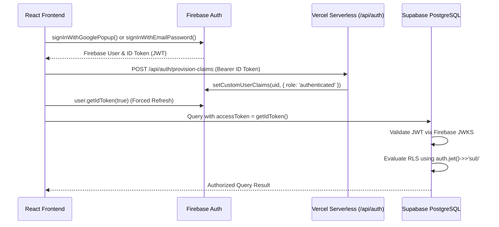

# Firebase + Supabase Authentication Integration Guide

## 1. How It Works

FitPlus retains **Firebase Authentication** as the sole end-user authentication provider. 
Supabase accepts Firebase ID tokens as valid third-party JWTs via Supabase's Third-Party Auth integration:



---

## 2. Supabase Third-Party Auth Configuration

In the Supabase Dashboard:
1. Navigate to **Authentication** > **Providers** > **Third-Party Auth**.
2. Select **Firebase Auth**.
3. Enter your Firebase Project ID: `gen-lang-client-0381020502`.
4. Supabase will automatically fetch the public keys from Google's JWKS endpoint (`https://www.googleapis.com/service_accounts/v1/jwk/securetoken@system.gserviceaccount.com`).

---

## 3. RLS Token Extraction

In all PostgreSQL Row Level Security policies, the Firebase UID is extracted using the `current_firebase_uid()` function:

```sql
CREATE OR REPLACE FUNCTION current_firebase_uid()
RETURNS TEXT
LANGUAGE sql
STABLE
AS $$
  SELECT coalesce(
    auth.jwt()->>'sub',
    auth.jwt()->>'user_id',
    current_setting('request.jwt.claim.sub', true)
  );
$$;
```

---

## 4. Custom Claim Provisioning

Supabase verifies that the incoming token contains `role: "authenticated"` to treat the caller as a logged-in user (rather than `anon`).
The endpoint `POST /api/auth/provision-claims` securely sets this claim server-side using the Firebase Admin SDK.
