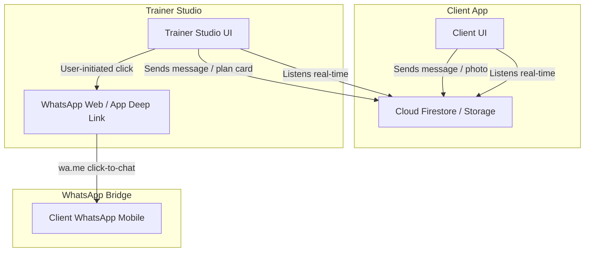

# FitPlus Connect — Real-Time Messaging Architecture

> **Module**: FitPlus Connect (In-App Coach–Client Messaging & WhatsApp Bridge)  
> **Target Audience**: Coaches, Clients, System Administrators  
> **Technologies**: Cloud Firestore (Real-time `onSnapshot`), Firebase Storage, React 19, TypeScript, WhatsApp Protocol Deep Links  

---

## 1. Architectural Overview & Design Philosophy

FitPlus Connect provides high-fidelity, real-time communication between fitness coaches and their active clients. Modeled on Apple Messages and crafted with FitPlus's Liquid Glass design language, it eliminates context switching and keeps coaching conversations, workout feedback, and plan revisions in one unified workspace.



### Core Design Principles
1. **Zero Third-Party Vendor Locks**: Native Firestore real-time listeners for chat and standard URL schemes (`wa.me`) for WhatsApp. No expensive third-party messaging APIs (e.g. Twilio or SendGrid) required.
2. **Apple-Inspired Liquid Glass UI**: Frosted glass message bubbles, responsive spring transitions, subtle glow effects, and tactile haptic feedback on touch devices.
3. **Coaching Context Awareness**: Messages natively support rich references to workout programs and meal plans, enabling clients and coaches to discuss specific routines with single-tap navigation.
4. **Client Privacy First**: WhatsApp messages are exclusively user-initiated by the coach. No automated unsolicited SMS or WhatsApp spam.

---

## 2. Data Model & Firestore Schema

FitPlus Connect utilizes a top-level `/conversations` collection with a nested `/messages` subcollection to ensure scalable, low-latency querying and linear cost scaling.

### 2.1 Conversations Collection (`/conversations/{conversationId}`)

**Deterministic Document ID**:
```typescript
export function buildConversationId(userAId: string, userBId: string): string {
  return [userAId, userBId].sort().join('__');
}
```
Sorting the two participant user IDs ensures a canonical 1-to-1 conversation path between any client and coach without query overhead.

**Conversation Document Schema**:
```typescript
interface ChatConversation {
  id: string; // e.g. "client_uid__trainer_uid"
  participantUserIds: [string, string];
  trainerUserId: string;
  clientUserId: string;
  lastMessageText: string;
  lastMessageTimestamp: string; // ISO 8601
  lastSenderUserId: string;
  unreadCountByUser: Record<string, number>; // { [userId]: count }
  createdAt: string;
  updatedAt: string;
}
```

### 2.2 Messages Subcollection (`/conversations/{conversationId}/messages/{messageId}`)

**Message Document Schema**:
```typescript
interface ChatMessage {
  id: string;
  conversationId: string;
  senderUserId: string;
  senderRole: 'client' | 'trainer';
  senderDisplayName: string;
  senderAvatarUrl?: string;
  text: string;
  attachmentUrl?: string;
  attachmentType?: 'image';
  planReference?: {
    type: 'workout' | 'nutrition';
    id: string;
    title: string;
    summary?: string;
  };
  replyToMessageId?: string;
  replyToSnippet?: string;
  readByUserIds: string[];
  createdAt: string; // ISO 8601
}
```

---

## 3. Security Rules & Access Control

Messaging security is enforced at both the Firestore and Firebase Storage layers:

### 3.1 Firestore Security Rules
```javascript
function isValidChatConversation(data) {
  return data.keys().hasAll(['id', 'participantUserIds', 'trainerUserId', 'clientUserId', 'createdAt', 'updatedAt']) &&
         data.participantUserIds is list &&
         data.participantUserIds.size() == 2 &&
         data.trainerUserId is string &&
         data.clientUserId is string;
}

function isValidChatMessage(data, conversationId) {
  return data.keys().hasAll(['id', 'conversationId', 'senderUserId', 'senderRole', 'text', 'readByUserIds', 'createdAt']) &&
         data.conversationId == conversationId &&
         data.senderUserId == request.auth.uid &&
         (data.senderRole == 'client' || data.senderRole == 'trainer') &&
         data.text is string && data.text.size() <= 4000;
}

// /conversations/{conversationId}
match /conversations/{conversationId} {
  allow read: if isVerifiedUser() && (request.auth.uid in resource.data.participantUserIds);
  allow create: if isVerifiedUser() && (request.auth.uid in request.resource.data.participantUserIds) && isValidChatConversation(request.resource.data);
  allow update: if isVerifiedUser() && (request.auth.uid in resource.data.participantUserIds);
  allow delete: if isAdmin();

  // /conversations/{conversationId}/messages/{messageId}
  match /messages/{messageId} {
    allow read: if isVerifiedUser() && (request.auth.uid in get(/databases/$(database)/documents/conversations/$(conversationId)).data.participantUserIds);
    allow create: if isVerifiedUser() &&
                     (request.auth.uid in get(/databases/$(database)/documents/conversations/$(conversationId)).data.participantUserIds) &&
                     isValidChatMessage(request.resource.data, conversationId);
    allow update: if isVerifiedUser() &&
                     (request.auth.uid in get(/databases/$(database)/documents/conversations/$(conversationId)).data.participantUserIds) &&
                     request.resource.data.diff(resource.data).affectedKeys().hasOnly(['readByUserIds']);
    allow delete: if isAdmin();
  }
}
```

### 3.2 Firebase Storage Rules
Image uploads for chat are segregated into `/private/messages/{conversationId}/{fileName}`:
```javascript
match /private/messages/{conversationId}/{fileName} {
  allow read: if request.auth != null &&
                 (request.auth.uid in get(/databases/$(database)/documents/conversations/$(conversationId)).data.participantUserIds);
  allow write: if request.auth != null &&
                  (request.auth.uid in get(/databases/$(database)/documents/conversations/$(conversationId)).data.participantUserIds) &&
                  request.resource.size < 5 * 1024 * 1024 &&
                  request.resource.contentType.matches('image/.*');
}
```

---

## 4. UI Components & Interaction Design

The chat frontend is built with modular, high-performance components:

1. **`ChatConversationList`**:
   - Filter search bar with real-time text matching.
   - User avatar with online indicator and role badge (`Client` vs `Coach`).
   - Last message snippet with relative timestamp formatted for Indian users (`"2m ago"`, `"Today, 10:45 AM"`).
   - Glowing amber badge (`#FF803E`) displaying the unread message count.

2. **`ChatMessageBubble`**:
   - Sent messages styled with an energetic orange-to-crimson gradient (`from-brand-primary to-orange-500`) with rounded corner accents.
   - Received messages styled with a frosted glass backdrop (`bg-glass border border-glass-border`).
   - Sent/read receipts featuring double checkmarks.
   - Clickable plan cards navigating to the referenced workout or nutrition program.
   - Fullscreen modal preview for attached photos.

3. **`ChatComposer`**:
   - Floating glass bar with auto-resizing input field.
   - Photo attachment picker supporting camera and gallery capture (with client-side image compression).
   - Plan reference selector allowing coaches to attach client plans with one click.
   - Replying banner displaying the quoted message snippet.

---

## 5. WhatsApp Click-to-Chat Communication Bridge

The `WhatsAppShareModal` component provides coaches with a direct, friction-free way to reach clients on WhatsApp without sharing private phone numbers across public databases or paying per-message API fees.

### Deep Link Generation Formula
```typescript
export function buildWhatsAppChatUrl(phone: string, text: string): string {
  const cleanPhone = phone.replace(/[^0-9]/g, '');
  return `https://wa.me/${cleanPhone}?text=${encodeURIComponent(text)}`;
}
```

### Pre-formatted Indian Coaching Templates
Coaches can pick from four tailored templates:
1. **Workout Plan Assigned**:
   > *"Namaste [Client Name]! Your new workout program '[Program Name]' ([Days] days/week) has been published on FitPlus. Let's crush this week: https://fitplus-kappa.vercel.app/app/workout"*
2. **Weekly Check-In Reminder**:
   > *"Hi [Client Name]! It's time for your weekly check-in. Please log your energy, sleep, and progress on FitPlus today: https://fitplus-kappa.vercel.app/app/check-in"*
3. **Streak Milestone Encouragement**:
   > *"Congratulations [Client Name]! You've reached a [N]-day workout streak on FitPlus! Keep up the incredible momentum!"*
4. **Custom Update / Plan Feedback**:
   > *"Hi [Client Name]! I have reviewed your workout logs and updated your routine. Take a look here: https://fitplus-kappa.vercel.app/app"*
