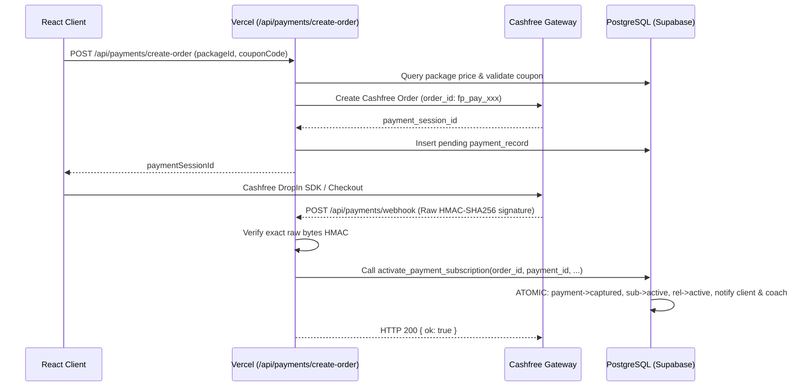

# FitPlus Cashfree Payment & Financial Infrastructure Verification

## 1. Gateway Configuration

- **Provider**: Cashfree Payments India
- **API Version**: `2025-01-01`
- **Environment**: Sandbox (Testing)
- **Currency**: INR (Authoritative integer paise calculations)
- **Supported Payment Modes**: UPI (Google Pay, PhonePe, Paytm, BHIM), Netbanking (All major Indian banks), Credit/Debit Cards.

---

## 2. Payment Flow Verification

---

## 3. Financial Integrity Controls

1. **Integer Paise Precision**: All currency math uses exact integers (`amount_paise = amount_inr * 100`). No floating-point inaccuracies.
2. **Idempotency & Duplicate Webhooks**: `activate_payment_subscription` checks if the payment record is already in `captured` status. If already processed, it returns immediately without creating duplicate subscriptions or enrollments.
3. **Coupon Protection**: Promotional discounts (`WELCOME20`, `FITPLUS500`, `TRANSFORM10`) are strictly calculated on the server and verified against minimum order requirements.
4. **Self-Referral Prevention**: Referrers cannot redeem their own referral codes.
5. **Trainer Settlements**: The earnings studio clearly distinguishes gross captured sales from net settlements. Cashfree Easy Split remains safely disabled until approved by Cashfree risk teams.
